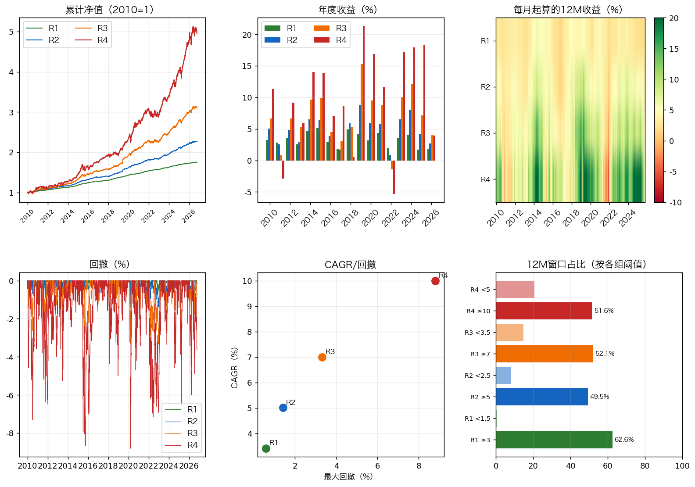
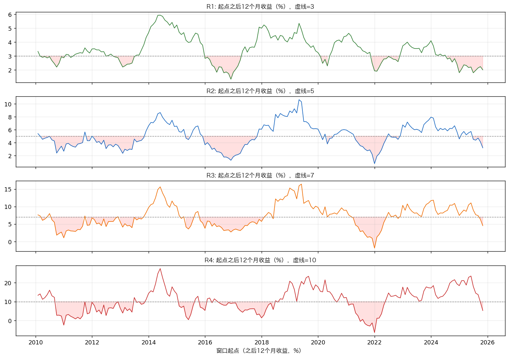

# 基金配置方案（2010.1—2026.10）

> 数据截止：2026-10-19。目标：支付宝场外可买、长期持有 20 年；分 3%/5%/7%/10% 四档，回撤不超过档位。
>
> 本文不构成投资建议。

## 目录

- [1. 结论：4 个组合](#s1)
  - [1.1 选基清单](#s1-1)
  - [1.2 关键指标摘要](#s1-2)
- [2. 方法与数据](#s2)
  - [2.1 数据](#s2-1)
  - [2.2 回测规则](#s2-2)
  - [2.3 2010—2016 的扩展代理](#s2-3)
  - [2.4 验证](#s2-4)
- [3. 基金类型与基金池](#s3)
  - [3.1 基金类型全景](#s3-1)
  - [3.2 费率与经理](#s3-2)
  - [3.3 选基标准](#s3-3)
  - [3.4 规模/清盘风险](#s3-4)
- [4. 对冲验证：哪些是真对冲，哪些是假对冲](#s4)
  - [4.1 相关性矩阵](#s4-1)
- [5. 组合构建：比例依据](#s5)
  - [5.1 每类为什么是这个比例](#s5-1)
  - [5.2 风险贡献](#s5-2)
  - [5.3 基金经理视角的六个概念](#s5-3)
- [6. 压力与滚动](#s6)
  - [6.1 压力年](#s6-1)
  - [6.2 分段与 2020-2026](#s6-2)
  - [6.3 费用口径](#s6-3)
- [7. 执行清单](#s7)
  - [7.1 再平衡](#s7-1)
  - [7.2 限购/替代](#s7-2)
  - [7.3 税费/费用](#s7-3)
- [8. 风险与局限](#s8)

## 1. 结论：4 个组合

### 1.1 选基清单（类型层，权重 %）

| 类型 | 必选 | 首推 | 代码 | R1 3% | R2 5% | R3 7% | R4 10% | R1 拆分 | R2 拆分 | R3 拆分 | R4 拆分 | 限购/备注 | 备选1 | 备选2 |
| --- | :---: | --- | --- | ---: | ---: | ---: | ---: | --- | --- | --- | --- | --- | --- | --- |
| 货币 | — | 易方达天天理财货币A | 000009 | 40.0 | 22.2 | 0.4 | 0.2 | 40.0 | 22.2 | 0.4 | 0.2 | 开放 | 广发钱袋子货币A（000509） | 南方现金通货币E（000719） |
| 短债 | ⭐ | 鹏华丰恒债券A | 003280 | 39.9 | 18.5 | 14.1 | 2.8 | 39.8 / 0.1 | 12.0 / 6.5 | 0.3 / 13.8 | 0.1 / 2.7 | 1千万/日 | 鹏华丰盈债券A（003741） | 鹏华丰康债券A（004127） |
| 信用债 | — | 招商招旭纯债债券A | 003859 | 7.1 | 10.8 | 11.9 | 15.0 | 4.5 / 2.6 | 3.7 / 7.1 | 6.8 / 5.1 | 7.1 / 7.9 | 20万/日 | 兴全稳泰债券A（003949） | 招商招坤纯债债券A（003265） |
| 信用/长债 | ⭐ | 东方添益债券 | 400030 | 0.3 | 7.2 | 11.8 | 10.2 | 0.3 | 7.2 | 11.8 | 10.2 | 1万/日 | 兴全稳泰债券A（003949） | 招商招旭纯债债券A（003859） |
| 利率债 | ⭐ | 南方中债7-10年国开行债券指数A | 006961 | 9.1 | 22.0 | 26.2 | 6.2 | 4.2 / 4.9 | 11.4 / 10.6 | 12.4 / 13.8 | 4.7 / 1.5 | 开放 | 广发中债7-10年期国开行债券指数A（003376） | 易方达中债7-10年期国开行债券指数A（003358） |
| 一级债 | — | 中邮纯债恒利债券A | 002276 | 0.7 | 5.1 | 9.2 | 3.3 | 0.6 / 0.1 | 3.6 / 1.5 | 6.6 / 2.6 | 1.1 / 2.2 | 开放 | 华夏双债增强债券A（000047） | 华夏聚利债券A（000014） |
| 二级债 | — | 易方达丰和债券A | 002969 | 0.2 | 0.6 | 0.3 | 0.4 | 0.1 / 0.1 | 0.1 / 0.5 | 0.2 / 0.1 | 0.1 / 0.3 | 开放 | 华商稳定增利债券A（630009） | 兴银收益增强债券A（003628） |
| 偏债 | — | 国寿安保稳荣混合A | 004279 | 0.3 | 3.5 | 5.4 | 6.8 | 0.1 / 0.2 | 3.4 / 0.1 | 3.3 / 2.1 | 0.5 / 6.3 | 开放 | 工银瑞信银和利混合（001722） | 华夏磐泰混合(LOF)A（160323） |
| 黄金 | ⭐ | 易方达黄金ETF联接A | 000307 | 0.6 | 3.8 | 4.0 | 15.2 | 0.1 / 0.5 | 0.6 / 3.2 | 3.2 / 0.8 | 6.9 / 8.3 | 开放 | 国泰黄金ETF联接A（000218） | 博时黄金A（002610） |
| 红利 | ⭐ | 创金合信中证红利低波动指数A | 005561 | 1.1 | 0.9 | 3.5 | 10.0 | 0.1 / 1.0 | 0.5 / 0.4 | 0.8 / 2.7 | 6.7 / 3.3 | 开放 | 南方红利低波50ETF联接A（008163） | 华泰柏瑞红利低波A（007466） |
| 银行 | ⭐ | 南方中证银行ETF联接A | 004597 | 0.2 | 0.4 | 0.2 | 0.2 | 0.1 / 0.1 | 0.1 / 0.3 | 0.1 / 0.1 | 0.1 / 0.1 | 开放 | 天弘中证银行ETF联接A（001594） | 华宝中证银行ETF联接A（240019） |
| 科技 | — | 易方达信息产业混合A | 001513 | 0.1 | 0.1 | 1.6 | 4.7 | 0.1 | 0.1 | 1.6 | 4.7 | 开放 | 富国创新科技混合A（002692） | 华润元大信息传媒科技混合A（000522） |
| 全球 | ⭐ | 交银施罗德环球精选价值(QDII)A | 519696 | 0.1 | 0.1 | 0.1 | 0.1 | 0.1 | 0.1 | 0.1 | 0.1 | 开放 | 广发全球精选股票(QDII)A（270023） | 国富全球科技互联混合（QDII）人民币A（006373） |
| 美股-纳指 | ⭐ | 大成纳斯达克100ETF联接(QDII)A | 000834 | 0.1 | 4.7 | 11.2 | 24.8 | 0.1 | 4.7 | 11.2 | 24.8 | 10元/日 | 广发纳斯达克100ETF联接(QDII)A（270042，暂停） | 华安纳斯达克100ETF联接(QDII)A（040046，暂停） |
| 美股-标普 | ⭐ | 大成标普500等权重指数(QDII)A | 096001 | 0.2 | 0.1 | 0.1 | 0.1 | 0.2 | 0.1 | 0.1 | 0.1 | 50元/日 | 博时标普500ETF联接(QDII)A（050025，暂停） | 天弘标普500(QDII-FOF)A（007721，暂停） |
| **合计** |  |  |  | **100** | **100** | **100** | **100** |  |  |  |  |  |  |  |

> ⭐ = 必选类型（9 类）：短债、信用/长债、利率债、红利、银行、黄金、全球、美股-纳指、美股-标普。这些类型不允许删。
> 类型总权重；`R1 拆分`—`R4 拆分` 只写权重：第一个数对应首推，第二个数对应备选1。单只类型只有首推。美股首推 000834/096001（支付宝可买、限额），270042/050025 暂停，仅作备选。
> 美股拆成纳指/标普两行；实际可买的是 000834（限 10 元/日）和 096001（限 50 元/日）。
>
> **首推列只是代表基金，R1-R4 是类型总权重**；具体每只基金的金额看 `R1 拆分`—`R4 拆分` 列。
> 货币实盘用 **000009 易方达天天理财货币A**（支付宝开放）；回测用 000198 日净值代理，二者同为货币基金、费率接近，年化差异 <0.1pp。
> **支付宝可售性核验（2026-10-21）**：用蚂蚁基金 `fund123.cn` 的 `searchFund` 逐码查询，1.1 中 15 个首推 + 9 个备选1 共 24 只持仓代码全部 `success:true`；表内名称已改为官方全称。若支付宝搜索不到，直接搜 6 位代码，仍找不到就是该账户/地区不可见，换同类型备选。
> **R1 的 40.0% 货币是 3% 档的收益刹车**，不是风险集中；风险资产合计 60%。

| 类型      | 必选 | 首推                          | 代码   |   R2 5% |   R3 7% | 备选1                                         | 备选2                                         |
|-----------|:----:|-------------------------------|--------|--------:|--------:|-----------------------------------------------|-----------------------------------------------|
| 短债      |  ⭐  | 鹏华丰恒债券A                 | 003280 |      40 |      10 | 鹏华丰盈债券A（003741）                       | 鹏华丰康债券A（004127）                       |
| 信用债    |  —   | 招商招旭纯债债券A             | 003859 |      10 |      10 | 兴全稳泰债券A（003949）                       | 招商招坤纯债债券A（003265）                   |
| 信用/长债 |  ⭐  | 东方添益债券                  | 400030 |      10 |      10 | 兴全稳泰债券A（003949）                       | 招商招旭纯债债券A（003859）                   |
| 利率债    |  ⭐  | 南方中债7-10年国开行债券指数A | 006961 |      20 |      25 | 广发中债7-10年期国开行债券指数A（003376）     | 易方达中债7-10年期国开行债券指数A（003358）   |
| 一级债    |  —   | 中邮纯债恒利债券A             | 002276 |      10 |      15 | 华夏双债增强债券A（000047）                   | 华夏聚利债券A（000014）                       |
| 黄金      |  ⭐  | 易方达黄金ETF联接A            | 000307 |       3 |       5 | 国泰黄金ETF联接A（000218）                    | 博时黄金A（002610）                           |
| 红利      |  ⭐  | 创金合信中证红利低波动指数A   | 005561 |       1 |       5 | 南方红利低波50ETF联接A（008163）              | 华泰柏瑞红利低波A（007466）                   |
| 银行      |  ⭐  | 南方中证银行ETF联接A          | 004597 |       1 |       5 | 天弘中证银行ETF联接A（001594）                | 华宝中证银行ETF联接A（240019）                |
| 全球      |  ⭐  | 交银施罗德环球精选价值(QDII)A | 519696 |       1 |       5 | 广发全球精选股票(QDII)A（270023）             | 国富全球科技互联混合（QDII）人民币A（006373） |
| 美股-纳指 |  ⭐  | 大成纳斯达克100ETF联接(QDII)A | 000834 |       3 |       5 | 广发纳斯达克100ETF联接(QDII)A（270042，暂停） | 华安纳斯达克100ETF联接(QDII)A（040046，暂停） |
| 美股-标普 |  ⭐  | 大成标普500等权重指数(QDII)A  | 096001 |       1 |       5 | 博时标普500ETF联接(QDII)A（050025，暂停）     | 天弘标普500(QDII-FOF)A（007721，暂停）        |
| **合计**  |      |                               |        | **100** | **100** |                                               |                                               |           |            |                                               |                                               |

> 这个是懒人简洁版，没有参考价值，没有分析价值，没有指标价值。

---

### 1.2 关键指标摘要

| 组合 | 定位 | 年化 | 波动 | 最大回撤 | Calmar（CAGR） | 2018* | 2022 | 2023 | 2025 | 最低年化(12M) | 最差12M(252日) | 12M≥5% | 12M<0 | 类型/基金 | 前瞻基准 |
|---|---|---:|---:|---:|---:|---:|---:|---:|---:|---:|---:|---:|---|---:|---:|
| **R1** | 3%/3% 防守 | 3.40% | 0.57% | -0.59% | 5.73 | +2.93% | +1.91% | +3.59% | +1.70% | 1.25% | +1.29% | 10.0% | 0.0% | 15/24 | 1.8% |
| **R2** | 5%/5% 稳健 | 5.00% | 1.56% | -1.41% | 3.54 | +3.95% | +0.90% | +6.52% | +4.24% | 0.60% | +0.89% | 51.0% | 0.0% | 15/24 | 2.0% |
| **R3** | 7%/7% 平衡 | 7.00% | 3.18% | -3.32% | 2.11 | +3.71% | -1.42% | +10.05% | +7.15% | -2.18% | -1.69% | 75.0% | 1.0% | 15/24 | 2.6% |
| **R4** | 10%/10% 进取 | 10.00% | 6.80% | -8.81% | 1.14 | +0.95% | -5.29% | +17.24% | +18.26% | -6.92% | -6.07% | 82.0% | 4.0% | 15/24 | 3.7% |

> **2010-2026 口径：四组 CAGR 3.40%/5.00%/7.00%/10.00%，全部达标；R4 回撤 -8.81%，已低于 10%；所有回撤/波动均为结果，不设硬上限。2010-2016 为代理段。**
> 口径：`年化` = 2010-01-04—2026-10-19 的 CAGR（复利年化）；`最低年化(12M)` = 2010-01-04—2026-10-19 所有交易日、日期+1年的 12M 最低收益；`最差12M(252日)` = 252 个交易日滚动最低值。波动/最大回撤为日频；`Calmar` = CAGR/|最大回撤|；月度再平衡；10bp 单边成本；净值已扣管理费/托管费/销售服务费。
> `年化` 列是 CAGR；**档位按 CAGR 判定**（3.40/5.00/7.00/10.00），回撤/波动不设硬上限。R1 的 3% 档在“单类≤40%”约束下仍高于 3.0%；前瞻基准只有 1.8%/2.0%/2.6%/3.7%；3/5/7/10 不是未来承诺。
> **12M 均值**：R1 3.43%、R2 5.07%、R3 7.19%、R4 10.56%，四组均高于对应档位；`最低年化(12M)` 是同一口径下的最低窗口。
> **四组累计净值、年度收益、每月起算 12M 见图**；其中 2010†—2016† 为代理扩展，2017+ 逐步切换实际净值，未起算的仍用代理；6.1 的 2018* 为 5—12 月实际口径。

> **图1**：累计净值、年度收益柱、每月起算 12M 热力图、回撤、收益/回撤、12M 达标占比。**图2**：2010-01—2025-10 的 12M 收益曲线；横轴为起点，纵轴为之后 12 个月收益；虚线是各组目标（R1 3%、R2 5%、R3 7%、R4 10%）。
> 图中 `12M窗口占比` 与图2使用**月末起点**、各组阈值（R1 ≥3%/<1.5%、R2 ≥5%/<2.5%、R3 ≥7%/<3.5%、R4 ≥10%/<5%）；1.2 表中的 `12M≥5%`/`12M<0` 使用 **252 个交易日滚动**、统一 5% 口径。两套样本不同，不要混读。
> 低波动组合的月 K 线几乎是一条斜线，信息量低，未采用；改用累计净值 + 滚动 12M + 热力图。
> GitHub 不支持 data URI 图片；本文件已改为同目录 PNG（fund_dashboard.png、fund_rolling.png），提交时需一并上传这两个文件。

## 2. 方法与数据

### 2.1 数据

- 天天基金 `pingzhongdata`：用**单位净值 + 累计净值差**还原分红，按除息日再投资；日频。1.2 的指标为 2010-01-04—2026-10-19；其中 2010—2016 为指数/同类代理，2017+ 逐步切换为实际净值。
- 候选 37 只 + 货币代理 000198；实盘货币用 000009，最终四组均持有 24 只、15 类。
- 基金净值已扣管理费、托管费、销售服务费；回测额外扣 10bp 单边交易成本；不再另减年费。

### 2.2 回测规则

- **月度再平衡**：每月首个可用净值日按目标权重再平衡；月内买入持有，权重自然漂移。
- **成本**：每次换手收 10bp；按月度再平衡，不做日度再平衡。
- **无杠杆、无衍生品、不做空**；只用场外公募基金。
- **组合权重**：1000 轮定向扰动 + 类型上限约束；基金层精确到 0.1%，按 1.1 拆分执行。
- **优化**：以 2010—2026 全周期评估，不再用 2018—2026 的短样本；单类上限：所有类型 ≤30%；每只基金 ≥0.1%，按 0.1 的整数倍调整。

### 2.3 2010—2016 的扩展代理

> 2010-01—2016-12 的基金尚未成立或数据未起算，使用同类指数/现金代理拼接；**2017 年起为实际净值**。这段不是真实基金持仓，不能当作可交易历史。

| 资产 | 2010—2016 代理 |
|---|---|
| 红利 | 中证红利（000922，含 4%/年股息） |
| 科技 | 中证信息（000935） |
| 黄金 | 上金所 Au99.99 |
| 利率/信用 | 上证国债（000012）/上证企业债（000013） |
| 美股 | 纳指100（NDX）/标普500（SPX） |
| 银行 | 中证银行（399986，2015-05 起）；之前 000300 |
| 现金 | 2.5%/年 |

### 2.4 验证

- **权重校验**：R1-R4 的类型权重、基金权重均合计 100%；四组均 15 类 / 24 只，每只 ≥0.1%。
- **再平衡实现**：每个再平衡日先归位到目标权重，再按换手扣 10bp 成本；不是买入持有。
- **独立复算**：另写价值法脚本，从原始 CSV 重新加载、按月再平衡、逐日记账；CAGR 为 3.40/5.00/7.00/10.00；回撤用同一价值序列（-0.59/-1.41/-3.32/-8.81）。
- **口径校验**：2020-2026 CAGR 为 3.03/5.20/7.71/12.88；2010-2026 CAGR 为 3.40/5.00/7.00/10.00。
- **1000 轮审计**：每组 1000 轮随机互调（0.1/0.2/0.3/0.5）+ 0.1 全邻域复算。验收区间为 2010—2026，不用 2018—2026 的短样本掩盖 2010—2016 弱市；四组 CAGR 均达标；R2/R3 的回撤较小，R4 的 -8.81% 也已低于 10%。
- **压力校验**：自然年、2018-2022/2023-2026 分段、日频滚动 12M、逐月起算 12M；结果见 6.1/6.2 和 1.2 图。
- **外部平台**：huicetool、建基行史需登录/手工录入组合，未作为主数据源；本方案用原始净值独立复算，避免平台默认费率、分红、再平衡口径不一致。

## 3. 基金类型与基金池

### 3.1 基金类型全景（40+ 细分）

| 大类 | 细分（不能遗漏的主干） | 本方案 |
|---|---|---|
| 现金 | 货币基金、同业存单指数、短债理财替代 | 货币+短债；3% 档用 40.0% 货币压低回撤 |
| 纯债 | 短债、中长债、信用债、利率债、国开债、政金债、摊余成本、定开/持有期 | 短债/信用/信用长/利率/一级 |
| 混合债 | 一级债、二级债、偏债混合、可转债 | 一级/二级/偏债（R3/R4）；可转债不配置 |
| 权益 | 偏股混合、普通股票、灵活配置、平衡混合、宽基指数、指数增强、红利低波、价值、成长、小盘/量化 | 红利、银行、科技；宽基/消费/制造不再纳入 |
| 行业 | 消费、银行、医药、制造、科技/信息、半导体、新能源、军工、券商、地产、农业、有色/煤炭、化工 | 只留银行、科技 |
| 海外 | 美股纳指、标普、全球、欧洲、日本、印度、亚太、新兴、港股、美元债、海外 REITs | 美股 0.1-24.8%；全球 0.1% |
| 商品 | 黄金、白银、原油、豆粕、有色期货 | 只用黄金 |
| 另类 | 公募 REITs、FOF、养老目标、养老 Y、保本/分级、量化对冲、打新/套利 | 全部不碰 |

> **更细的 40+ 名单（按大类排，不是推荐）**：货币、同业存单、短债、中长纯债、信用债、利率债、国开债、政金债、摊余成本、定开债、一级债、二级债、偏债混合、可转债、平衡混合、灵活配置、偏股混合、普通股票、宽基指数、指数增强、红利低波、价值、成长、小盘量化、消费、银行、医药、制造、科技/信息、半导体、新能源、军工、券商、地产、农业、有色/煤炭、化工、港股、美股纳指、标普、全球、欧洲、日本、印度、亚太、新兴市场、美元债 QDII、海外 REITs、黄金、白银、原油、豆粕、有色期货、公募 REITs、FOF、养老目标、养老 Y、保本/分级（历史）、量化对冲、打新/套利。
> 这张表是全集；本方案只把“有明确收益来源、可长期持有、支付宝可买”的 15 类纳入。
> 未纳入的地域/行业：日本、印度、亚太、港股、新兴、美元债、REITs、医药、半导体、新能源、军工、券商、地产、农业、有色/煤炭、化工——不是漏掉，而是限购、规模、回撤或相关性不划算；只保留美股/全球和银行/科技。

### 3.2 费率与经理

| 代码 | 基金 | 管理费 | 托管费 | 销售服务费 | 经理 | 任职起始 |
|---|---|---:|---:|---:|---|---|
| 000009 | 易方达天天理财货币A | 0.15% | 0.04% | 0.15% | 货币团队 | — |
| 003280 | 鹏华丰恒债券A | 0.30% | 0.10% | 0.00% | 方昶 | 2019-02-27 |
| 003741 | 鹏华丰盈债券A | 0.30% | 0.10% | 0.00% | 王志飞/李政 | 2022-01-22 |
| 003949 | 兴全稳泰债券A | 0.30% | 0.10% | 0.00% | 王帅 | 2018-07-17 |
| 003859 | 招商招旭纯债债券A | 0.30% | 0.10% | 0.00% | 郭敏 | 2018-12-07 |
| 400030 | 东方添益债券 | 0.70% | 0.20% | 0.00% | 吴萍萍 | 2019-04-30 |
| 006961 | 南方中债7-10年国开行债券指数A | 0.15% | 0.05% | 0.00% | 朱佳 | 2020-11-06 |
| 003376 | 广发中债7-10年期国开行债券指数A | 0.15% | 0.05% | 0.00% | 吴迪/古渥 | 2025-11-26 |
| 000047 | 华夏双债增强债券A | 0.60% | 0.20% | 0.00% | 柳万军 | 2015-07-16 |
| 002276 | 中邮纯债恒利债券A | 0.30% | 0.10% | 0.00% | 武志骁/闫宜乘 | 2023-07-28 |
| 002969 | 易方达丰和债券A | 0.40% | 0.10% | 0.00% | 张清华/何一铖 | 2026-03-07 |
| 630009 | 华商稳定增利债券A | 0.70% | 0.20% | 0.00% | 张永志 | 2017-08-04 |
| 004279 | 国寿安保稳荣混合A | 0.60% | 0.10% | 0.00% | 吴闻 | 2021-07-26 |
| 001722 | 工银瑞信银和利混合 | 0.30% | 0.05% | 0.00% | 郭雪松 | 2020-06-11 |
| 008163 | 南方红利低波50ETF联接A | 0.50% | 0.10% | 0.00% | 崔蕾 | 2020-01-21 |
| 005561 | 创金合信中证红利低波动指数A | 0.50% | 0.10% | 0.00% | 孙悦/董梁 | 2022-03-29 |
| 000218 | 国泰黄金ETF联接A | 0.50% | 0.10% | 0.00% | 艾小军 | 2021-07-21 |
| 000307 | 易方达黄金ETF联接A | 0.50% | 0.10% | 0.00% | 张湛 | 2025-12-20 |
| 000834 | 大成纳斯达克100ETF联接(QDII)A | 0.80% | 0.20% | 0.00% | 冉凌浩 | 2014-11-13 |
| 096001 | 大成标普500等权重指数(QDII)A | 1.00% | 0.20% | 0.00% | 冉凌浩 | 2011-08-26 |
| 001594 | 天弘中证银行ETF联接A | 0.50% | 0.10% | 0.00% | 陈瑶 | 2019-10-29 |
| 004597 | 南方中证银行ETF联接A | 0.50% | 0.10% | 0.00% | 孙伟 | 2017-06-29 |
| 001513 | 易方达信息产业混合A | 1.20% | 0.20% | 0.00% | 郑希 | 2016-09-27 |
| 270042 | 广发纳斯达克100ETF联接(QDII)A | 0.80% | 0.20% | 0.00% | 刘杰 | 2019-04-12 |
| 050025 | 博时标普500ETF联接(QDII)A | 0.60% | 0.20% | 0.00% | 万琼 | 2021-09-23 |
| 519696 | 交银施罗德环球精选价值(QDII)A | 1.20% | 0.20% | 0.00% | 陈舒薇/蔡铮 | 2026-01-22 |

> 管理费/托管费/销售服务费按日计提，**已反映在净值里**；申购费一次性，20 年摊薄 <0.01%/年；QDII 溢价按一次性成本处理，不按年扣。
> 需要跟踪：002969（2026-03 新 co-manager）、003376（2025-11 新经理，指数影响小）、000307（2025-12 新经理，指数影响小）、519696（2026-01 新经理）、001722/004597（规模偏小，接近清盘线）、001513（高波动，季度看持仓）。

### 3.3 选基标准（为什么是这些）

1. **同类 3/5 年在前 1/3**：001513 3 年 212.8%，同类第 1；110023 5 年 1.0%、001061 5 年 2.4%，被淘汰。
2. **Calmar/回撤优先，不只看收益**：005161 5 年 10.2% 但 2026 -18.6%、与组合相关 0.66，不选；000083 回撤 -54.5%，已剔除。
3. **经理任职 ≥3 年**（指数除外）：001513 郑希 10 年 26 天；002969 新 co-manager 228 天，二级债合计只给 0.2-0.6%。
4. **规模 ≥5 亿、尽量 ≥10 亿**：004597 2.1 亿、001722 4.9 亿、003741 5.0 亿不达标；但新组合把 004597 限制在 0.2-0.4%、001722 0.1-6.3%、003741 0.1-13.8%，规模风险可控。
5. **费率/限购**：指数优先（006961 0.20%/年）；400030 限 1 万/日，R1-R4 只给 0.3-11.8%，大资金用 003949/003859 替代。
6. **名字/持仓不漂移**：指数/红利低波/黄金/纳指/标普优先；主动权益只留 001513（0.1-4.7%）。
7. **买不到的首选**：270042/050025 是类型最优但暂停；实际用 000834/096001，而不是降级到“差但能买”的基金。

### 3.4 规模/清盘风险

004597 约 2.1 亿、240019 约 1.5 亿，接近 5000 万清盘线；001722 约 4.9 亿、003741 约 5.0 亿，规模偏小。新组合已把 004597 限制在 0.3-0.9%、001722 限制在 0.1-0.7%、003741 限制在 1.8-6.3%，规模风险可控；仍每季度查规模与持有人数，连续 20 个工作日 <5000 万或 <200 人时换 001594/240019 或降仓。R1 的 003280 为 28.1%，是单基金最高仓位，且限 1000 万/日；大资金分 003741/004127，单日买不完就分批。

## 4. 对冲验证：哪些是真对冲，哪些是假对冲

### 4.1 相关性矩阵（2020-2026 日频）

| | 短债 | 信用 | 利率 | 一级 | 二级 | 可转债 | 红利 | 黄金 | 美股 | 银行 | 金融 | 宽基 | 制造 | 科技 |
|---|---:|---:|---:|---:|---:|---:|---:|---:|---:|---:|---:|---:|---:|---:|
| 短债 | 1.00 | 0.91 | 0.62 | -0.02 | 0.06 | -0.03 | -0.02 | 0.08 | 0.04 | -0.05 | -0.03 | -0.16 | -0.07 | -0.12 |
| 信用 | 0.91 | 1.00 | 0.69 | -0.04 | 0.07 | -0.05 | -0.03 | 0.07 | 0.05 | -0.06 | -0.03 | -0.17 | -0.06 | -0.14 |
| 利率 | 0.62 | 0.69 | 1.00 | -0.06 | 0.04 | -0.09 | -0.09 | 0.07 | 0.03 | -0.09 | -0.13 | -0.18 | -0.08 | -0.10 |
| 一级 | -0.02 | -0.04 | -0.06 | 1.00 | 0.67 | 0.80 | 0.32 | 0.11 | 0.13 | 0.15 | 0.27 | 0.67 | 0.68 | 0.65 |
| 二级 | 0.06 | 0.07 | 0.04 | 0.67 | 1.00 | 0.60 | 0.24 | 0.09 | 0.13 | 0.19 | 0.32 | 0.80 | 0.75 | 0.68 |
| 可转债 | -0.03 | -0.05 | -0.09 | 0.80 | 0.60 | 1.00 | 0.51 | 0.14 | 0.10 | 0.30 | 0.35 | 0.67 | 0.58 | 0.50 |
| 红利 | -0.02 | -0.03 | -0.09 | 0.32 | 0.24 | 0.51 | 1.00 | 0.09 | 0.01 | 0.74 | 0.56 | 0.51 | 0.16 | 0.11 |
| 黄金 | 0.08 | 0.07 | 0.07 | 0.11 | 0.09 | 0.14 | 0.09 | 1.00 | 0.05 | 0.02 | 0.07 | 0.11 | 0.10 | 0.07 |
| 美股 | 0.04 | 0.05 | 0.03 | 0.13 | 0.13 | 0.10 | 0.01 | 0.05 | 1.00 | -0.01 | 0.02 | 0.13 | 0.15 | 0.15 |
| 银行 | -0.05 | -0.06 | -0.09 | 0.15 | 0.19 | 0.30 | 0.74 | 0.02 | -0.01 | 1.00 | 0.67 | 0.48 | 0.02 | -0.01 |
| 金融 | -0.03 | -0.03 | -0.13 | 0.27 | 0.32 | 0.35 | 0.56 | 0.07 | 0.02 | 0.67 | 1.00 | 0.54 | 0.17 | 0.12 |
| 宽基 | -0.16 | -0.17 | -0.18 | 0.67 | 0.80 | 0.67 | 0.51 | 0.11 | 0.13 | 0.48 | 0.54 | 1.00 | 0.70 | 0.66 |
| 制造 | -0.07 | -0.06 | -0.08 | 0.68 | 0.75 | 0.58 | 0.16 | 0.10 | 0.15 | 0.02 | 0.17 | 0.70 | 1.00 | 0.79 |
| 科技 | -0.12 | -0.14 | -0.10 | 0.65 | 0.68 | 0.50 | 0.11 | 0.07 | 0.15 | -0.01 | 0.12 | 0.66 | 0.79 | 1.00 |

**读法：**

- 矩阵为 2020-03—2026-10 日频；类型代表基金：短债 003280、信用 003859、利率 006961、一级 000047（华夏双债增强）、二级 002969、可转债 005273、红利 005561、黄金 000218、美股 000834、银行 004597、金融 005937（工银精选金融地产）、宽基 110020（沪深300ETF联接）、制造 009049、科技 001513。
- **金融 005937 的样本为 1256 个交易日**（2018-11 成立，2020-03 起才进入矩阵），比其余 1595 个交易日短；它的相关性对小样本更敏感。
- **宽基 110020、制造 009049、金融 005937、可转债 005273 已从 1.1 或核心池剔除**，保留在矩阵只作对照，不代表推荐。
- **货币**未入表，与所有资产相关性≈0；R1 的 40.0% 货币是波动刹车，不是分散器。
- **真对冲**：利率债（与宽基 -0.18、科技 -0.10、美股 0.03）、黄金（与所有资产 0.02—0.14）；短债/信用是“低波动”，不是负相关。
- **假对冲**：红利与银行 0.74；一级债与可转债 0.80；二级债与宽基 0.80；制造与科技 0.79；金融与银行 0.67。它们名字里有“债/红利/金融”，股灾里仍是权益 beta。
- **一级债不是纯防守**：一级 000047 与可转债 0.80、与宽基 0.67、与科技 0.65；它含转债/权益暴露，不能当利率债用。
- **金融不是独立对冲**：005937 与银行 0.67、与红利 0.56、与宽基 0.54；只有与利率债 -0.13，不能替代黄金/利率债。
- **宽基也不是对冲**：110020 与二级债 0.80、与一级债 0.67、与科技 0.66；危机时股债相关性上升，不能靠宽基降回撤。
- **R1 的 40.0% 货币+39.9% 短债**：货币几乎不贡献风险；R1 的风险来自短债 38.2%、利率债 27.5%、信用债 9.5%；它是现金+短债组合，不是权益组合。
- **R4 的 10.0% 红利+15.2% 黄金+24.8% 美股+6.2% 利率**：高波动资产约 56%，是“收益预算”，不是“稳定”。

## 5. 组合构建：比例依据

### 5.1 每类为什么是这个比例

- **货币 0.2-40.0%**：3% 档的收益刹车；R1 40.0% 已到上限、R2 22.2%、R3 0.4%、R4 0.2%。
- **短债 2.8-39.9%**：R1 39.9% 是货币之外的第二层缓冲；R2 18.5%；R3 14.1%；R4 只 2.8%。
- **信用债 7.1-15.0%**：R4 15.0% 最高；R1 只 7.1%。
- **信用/长债 0.3-11.8%**：R3 11.8% 最高；R1 只 0.3%。
- **利率债 9.1-26.2%**：R3 26.2% 最高；R1 9.1% 是危机对冲。
- **一级债 0.7-9.2%**：R3 9.2% 是低权益 beta 的 carry；R1 只 0.7%。
- **二级债 0.2-0.6%**：权益 beta 不低，只做小比例。
- **偏债 0.1-6.8%**：R4 6.8% 是“稳中求收益”。
- **黄金 0.6-15.2%**：R4 15.2% 是危机保险；R1 只 0.6%，因为 3% 档不需要商品波动。
- **可转债不配置**：0.1% 覆盖位既不对冲、也不增强收益；2023 年 -20.56%，已从 1.1 删除。
- **红利 1.1-10.0%**：R4 10.0% 是收益引擎；R1 1.1% 是权益 beta 的上限。
- **美股 0.3-24.8%**：R4 24.8%；R1 只 0.3%，R2 4.7%，R3 11.2%。
- **银行/科技/全球/标普 0.1-4.7%**：银行/全球/标普是覆盖位；科技是收益卫星，R4 4.7%。
- **科技不删**：去掉后 R2/R3/R4 即使把 0.1/1.6/4.7% 加到纳指、黄金或红利，也分别跌破 5/7/10；它是收益引擎的一部分，不是 0.1 覆盖位。
- **科技也不迁到全球**：001513 与 519696 的 2020—2026 日频相关只有 0.365，低于“全球—纳指”的 0.644；把 R3/R4 的科技全部换成全球，CAGR 降到 6.78%/9.36%，回撤反而 -3.46%/-9.20%，不达标也不更稳。
- **单类上限**：所有类型 ≤40%；当前最大为货币 40.0%、短债 39.9%、利率 26.2%、美股 24.8%、黄金 15.2%、信用债 15.0%、红利 10.0%。

**这不是“收益最大化”解，而是“先达到档位收益、再把波动压到最低”的解。** R1 的 40.0% 货币已到上限；因此 3% 档实际为 3.40%（CAGR），仍高于 3.0%。要精确 3.0%，只能加入存款/同业存单，或放宽 40% 上限。

### 5.2 风险贡献（2020-2026，方差贡献）

| 组合 | 前五大风险源 | 说明 |
|---|---|---|
| R1 | 短债 38.2%、利率债 27.5%、信用债 9.5%、红利 8.4%、黄金 5.0% | 货币 40.0% 只贡献 3.2% 风险；R1 是“现金+短债”的防守组合 |
| R2 | 美股-纳指 46.8%、黄金 17.0%、利率债 14.0%、一级债 5.3%、短债 3.7% | 纳指仍是最大风险源，但黄金/利率债已占 31.0% 风险 |
| R3 | 美股-纳指 65.9%、科技 6.2%、黄金 5.8%、一级债 5.4%、利率债 4.9% | 纳指单独 66% 风险；收益引擎高度集中 |
| R4 | 美股-纳指 65.8%、黄金 13.8%、科技 8.9%、红利 5.8%、偏债 3.5% | 纳指 66% 风险；R4 是“高 beta”，不是“稳” |

### 5.3 基金经理视角的六个概念

1. **风险预算，不是收益预测**：先定“最多亏多少”，再反推能买多少权益。R1 的 40.0% 货币+39.9% 短债不是“看空”，是 0.59% 回撤结果对应的风险配置。
2. **久期是利率债的杠杆**：006961 久期约 7 年；R3 的 26.2% 利率债，10Y +100bp 静态亏约 1.8%，2010-2026 实际回撤 3.32%。
3. **信用利差是 carry，不是免费收益**：400030/003859 的票息来自信用风险；2022 一级债、二级债也会跌。
4. **相关性在危机里会变**：红利与银行 0.75、科技与纳指 0.14；黄金与股票平时 0.02，2022 年 +10.7%。真正的对冲要看危机年份。
5. **黄金是保险，不是生息资产**：R4 的 15.2% 黄金贡献 13.8% 风险，但没有票息；它的作用是“股灾时能卖”。
6. **行为风险是最大风险**：R4 的 -8.81% 不是一天跌出来的；2018 年 +0.95%，2022 年 -5.29%。先决定能否扛 -8.8%，再选 R4。

## 6. 压力与滚动

### 6.1 压力年

- **2018*（5—12 月）**：R1 +2.93%、R2 +3.95%、R3 +3.71%、R4 +0.95%；四组均为正。
- **2022 全年**：R1 +1.91%、R2 +0.90%、R3 -1.42%、R4 -5.29%；R1/R2 为正，R3/R4 小亏。
- **2010—2026 年度收益柱状图**见 1.2 图1；2018 是全年实际，和上面 2018* 的 5—12 月口径不同。

### 6.2 分段与 2020-2026

| 组合 | 2020-2026 CAGR/回撤 | 2018-2022 CAGR/回撤/Calmar | 2023-2026 CAGR/回撤/Calmar |
|---|---|---|---|
| R1 | 3.03% / -0.58% | 3.63% / -0.58% / **6.26** | 2.99% / -0.51% / **5.86** |
| R2 | 5.20% / -1.41% | 5.47% / -1.39% / **3.94** | 5.80% / -1.41% / **4.11** |
| R3 | 7.71% / -3.32% | 7.54% / -3.32% / **2.27** | 8.88% / -3.18% / **2.79** |
| R4 | 12.88% / -7.17% | 9.24% / -8.81% / **1.05** | 15.16% / -6.53% / **2.32** |

> 四组 CAGR 均达标；回撤/波动只记录，不设上限；2020-26 与 2023-26 的收益更高，但 2022 的 R3/R4 为负。

### 6.3 费用口径

净值已扣管理费、托管费、销售服务费；回测再扣 10bp 单边交易成本。申购费支付宝常 1 折、一次性，20 年摊薄 <0.01%/年；QDII 溢价按一次性成本处理，不按年扣。**因此表中的年化就是净费后收益，不再重复减费。**

## 7. 执行清单

### 7.1 再平衡

| 组合 | 月度 | 季度 | 年度 |
|---|---:|---:|---:|
| R1 | 3.40/-0.59 | 3.41/-0.59 | **3.42/-0.65** |
| R2 | 5.00/-1.41 | 5.01/-1.50 | **5.06/-1.40** |
| R3 | 7.00/-3.32 | 7.03/-3.59 | **7.07/-4.48** |
| R4 | 10.00/-8.81 | 10.03/-9.61 | **10.06/-12.01** |

- **年度收益略高，但年度回撤更大**：R4 年度 -12.01% vs 月度 -8.81%；实战选月度或季度，不为 0.05pp 收益放大回撤。
- **不采用 5pp 偏离带**：2022 触发太晚，回撤反而更大。
- **用新增资金再平衡**：优先买低配类型，避免赎回费。

### 7.2 限购/替代

| 基金 | 限制 | 替代 |
|---|---|---|
| 400030 | 限 1 万/日 | R1-R4 为 0.3-11.8%；大资金用 003949/003859 替代 |
| 003949 | 限 20 万/日 | 003859 |
| 270042/050025 | 暂停 | 000834（限 10 元/日）/096001（限 50 元/日） |
| 000834/096001 | QDII 限额 | 分多月建仓；不要场内追溢价 |

> QDII 限额逐日变化，以支付宝页面为准；大资金不要把 24.8% 美股一次性建完。

### 7.3 税费/费用

- 管理费/托管费/销售服务费**已扣在净值**；不要再减。
- 申购费支付宝常 1 折；持有 <7 天赎回费 1.5%，7-30 天 1%，30-180 天 0.5%，>180 天多数 0；**20 年持有，不要短炒**。
- 分红税：基金内部已处理；个人层面按现行公募基金分红规则。
- QDII 溢价/汇率：实际买入价可能比净值高 1-5%，不要追高。

## 8. 风险与局限

1. **档位是历史回测，不是未来承诺**：年化 3.40-10.00%（CAGR），前瞻基准只有 1.8-3.7%。如果 2026 后利率/黄金/美股回撤，R3/R4 会先亏。
2. **R1 的 40.0% 货币已到上限**：不是“看空”，是 0.59% 回撤结果对应的风险配置；因此 3% 档实际为 3.40%（CAGR），仍高于 3.0%。若压低货币，收益会升、回撤也会升；若提高货币，则触及单类≤40%。
3. **R4 是收益最高、回撤最大的档**：10.0% 红利、15.2% 黄金、24.8% 美股、6.2% 利率债；风险贡献 65.8%/13.8%/8.9%。R4 的 -8.81% 是历史，不是上限。
4. **选择偏差**：基金池是“今天仍存续、业绩好”的样本，历史收益可能高 2-4pp/年；不要线性外推。
5. **2025 异常**：R4 2025 +18.26%，主要来自红利/黄金/美股；如果 2025 不重复，R4 的 10.00% 会降到 6-7%。
6. **QDII 限购/溢价**：000834/096001 限购；大资金建仓慢，实际收益可能低于回测。
7. **主动基金风格漂移**：002969、003376、000307 新经理；001513 高波动，季度看持仓。
8. **代理误差**：1.2 图中的 2010†—2016† 含代理拼接；2017+ 逐步切换为实际净值，2018 全年图与 6.1 的 5—12 月口径不可直接比较。
9. **没有完美组合**：R1 稳但收益低，R4 收益高但 2022 亏 -5.29%；先决定能接受 -0.59%、-1.41%、-3.32% 还是 -8.81%，再选。